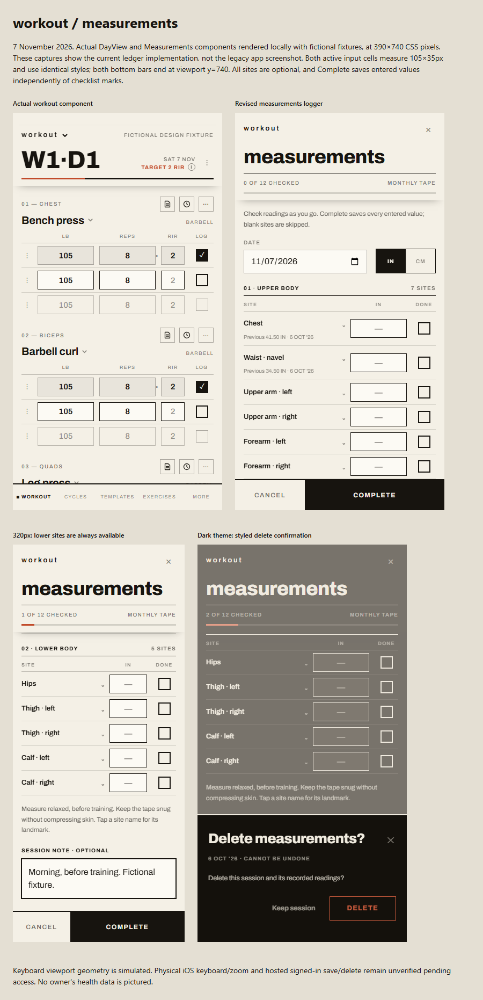

# Monthly tape — workout-layout correction

The owner rejected the prior mobile pass. This is a correction, not acceptance
of figures 4.13a–b or preview `91c4070`. Figures 4.13c–d in
`design/mockups/body-measurements-workout.html` precede this implementation.

## Ground truth

Reviewed the real `workout/page.tsx` → `DayView`, `SetRow`, `LogCheckbox`,
`CompleteSheet`, `BottomNav`, app shell, viewport and N47 scroll lock, alongside
figure 1.1 and the dated density amendments. The old `Workout_Page.PNG` is
historical and does not represent the current ledger UI.

The actual `DayView` component was rendered locally with fictional props inside
the real app shell's layout/PullToRefresh/BottomNav. Its live input styles were
compared with the measurement component in the same browser and viewport:

| CSS viewport width | Workout input width | Tape input width | Both heights |
| --- | --- | --- | --- |
| 320 | 70 | 70 | 35 |
| 360 | 90 | 90 | 35 |
| 390 | 105 | 105 | 35 |
| 430 | 125 | 125 | 35 |

Both use the same 15px, weight-600 centered/tabular values, square corners,
active border/paper and completed border/tint. `loggingCellClass` extracts the
existing literal classes without changing DayView's styles or behavior. The
actual `LogCheckbox` supplies the same 23px square/44px-wide target, with opt-in
checkbox semantics for measurements. No prescription or queue logic is reused.

The actual fixed navigation bar ends at viewport y=740. The new measurement
action bar also ends at y=740, including after field scrolling. It is a real
`position:fixed` sibling of the scroller in a body portal, with no arbitrary
bottom gap; only the app's safe-area inset is reserved. The content cap is 512px.
The day view's COMPLETE WORKOUT button itself is conditional inline content;
the new measurement bar follows BottomNav's viewport anchoring as the owner
requested, rather than claiming that inline button is already fixed.

## Interaction results and limits

Local typecheck/lint and 336 targeted tests pass with the staged 1.3.0 flag,
including tape, day rules, scroll/navigation, Guide and release contracts.
The temporary root fixture is restored, and the dev server is stopped.

- All 12 sites render together in upper/lower groups. Landmark disclosures hide
  explanations only. No reading is required individually.
- Checkmarks toggle, survive unit conversion/discard cancellation, and clear on
  value edits. They are a local checklist, not a row save. Complete validates
  and saves every entered value, including unchecked values; blank sites are
  skipped. The existing atomic save/RLS contract is unchanged.
- Keyboard Next follows the complete site list and reaches the note. Dirty
  Cancel opens LeaveConfirm; Keep editing retains inputs and checks.
- Themed deletion uses BottomSheet, Keep session and the app's destructive
  outline. Escape closes only the confirmation; the entry remains. No native
  browser confirmation remains. Actual save/delete persistence is covered by
  the local-Supabase CI scenario, not this visual fixture.
- Width/overflow, fixed actions, checklist behavior and CSS equivalence pass
  at 320/360/390/430; 768px confirms the 512px inner cap. Light and dark runtime
  captures were inspected. No page errors occurred.
- A simulated visual viewport of height 360, offset 24 puts the fixed bar's
  bottom at y=384 and keeps the focused note visible, even with a validation
  message. This is geometry coverage, not a physical keyboard test.

Fictional runtime captures and side-by-side reference are in
`design/reviews/body-measurements-workout-comparison.html`. Temporary fixtures
must be restored before commit/deploy. They do not access production or persist
readings. The root viewport maximumScale=1 remains the owner's existing policy;
physical iOS keyboard/zoom behavior is unverified.

Hosted interaction remains behind GitHub/Vercel sign-in in this agent's Chrome
session. Do not equate a READY deployment or protected HTTP sign-in response
with a verified signed-in save. No production test identities/readings, schema
change, merge or promotion is part of this correction. N84's broader smoke
failures remain tracked separately; final CI/preview status belongs in the
delivery checkpoint.

## Deployed UI checkpoint

Corrected preview: https://workout-873r403rx-garron-duprees-projects.vercel.app/more/measurements
READY deployment dpl_6t341sbHj3sooMVJB32ymNjJ7DBN, pinned to UI commit
ebffc809c6bf3d05be682feea6142b1db1fc436b. Build events confirm
NEXT_PUBLIC_RELEASE_OVERRIDE=1.3.0 npm run build; target is Preview.
Keep this URL pinned through documentation-only follow-ups.

CI [42386443416](https://github.com/norrag/workout/actions/runs/42386443416):
2,175 unit tests, 12 built service-worker guards, lint/typecheck/build,
84 RLS, 18 integration and hosted drift pass. Both targeted measurement
cases pass without retries (4.393/3.400s). The report contains nine mobile
screenshots; narrow top/bottom captures were inspected.

Full smoke is terminal red: **7 passed, 1 failed, 3 flaky, 0 skipped**.
BodySpec detail line 141 fails twice. BodySpec Keep current, macro closeout
and tape capture pass on retry. The tape failure is line 37, sign-in before
the form opens: HTTP 303 /workout;push after 91ms (receive 76ms), yet the
trace remains on /sign-in and records React 418. This matches the fresh
unchanged-main controls in the prior comparison; the warning does not prove
causation. Tape capture then passes in 3.9s; mobile geometry passes directly
in 3.3s. N84 remains open. No timeout inflation, bypass or speculative patch.

The actual protected preview returns app sign-in (200), with the served
viewport width=device-width, initial-scale=1, maximum-scale=1, viewport-fit=cover.
Hosted signed-in actions remain unverified pending GitHub/Vercel sign-in;
physical iOS keyboard/zoom is unverified. Local/CI records are synthetic.
No schema or production data mutation in this pass. Shared hosted DB status
is unchanged. Production frontend still uses aed94ce / release 1.2.1.
No merge or promotion. Draft PR #265 remains under owner review.

